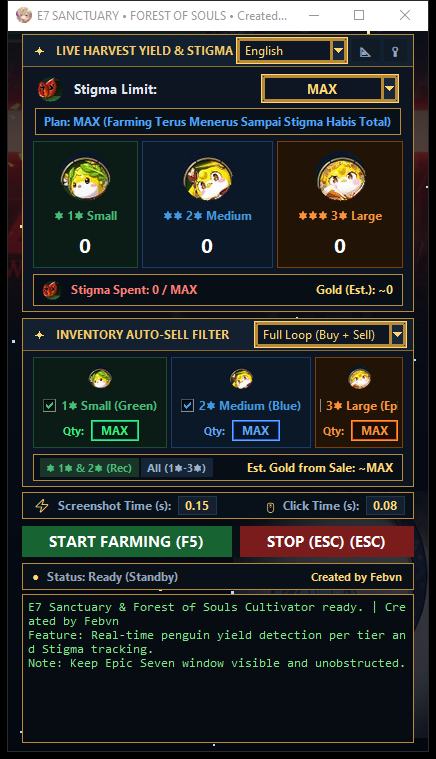

# E7 Penguin Farmer

**Automated penguin cultivation and selling tool for Epic Seven (PC client).**

<p align="center">
  
</p>

> **Language / Bahasa:** English (this file) | [Bahasa Indonesia](README_ID.md) | [한국어 / 日本語 / 中文 — in-app UI supported]

---

## What This Does

This bot automates the repetitive penguin farming loop inside Epic Seven's Sanctuary (Forest of Souls → Growth Altar). It handles purchasing penguins in bulk batches of 50, counting the results by star tier in real time, and optionally selling them from your inventory for gold — all through screen-reading and mouse automation on the PC client window.

Three operation modes are available:

| Mode | Description |
|---|---|
| **Full Loop** | Buy penguins in batches → tally the hatch results → open inventory → auto-sell selected tiers for gold |
| **Buy Only** | Buy penguins and tally results, skip selling |
| **Sell Only** | Skip buying, just sell penguins already sitting in your inventory |

---

## Features

- **Batch purchasing** — Buys 50 penguins per batch, repeating until your Stigma budget runs out or hits the limit you set.
- **Real-time yield tracking** — Counts how many 1★, 2★, and 3★ penguins you got per batch and in total, displayed live in the GUI.
- **Auto-sell with tier filter** — Choose which tiers to sell (1★, 2★, 3★) and how many of each. Defaults to selling 1★ and 2★ while keeping 3★ for EXP.
- **Stigma budget presets** — Quick-select buttons for common amounts (51,000 / 25,500 / 10,200 / 5,100) or type any custom number. "MAX" mode buys until Stigma is completely gone.
- **Speed tuning** — Adjust screenshot interval and mouse click delay to match your PC's performance.
- **6 UI languages** — English, 한국어, 日本語, 繁體中文, 简体中文, Bahasa Indonesia. The GUI switches language instantly.
- **Hotkeys** — `F5` to start, `ESC` for emergency stop.
- **Window snapping** — Pins the Epic Seven window to position (0,0) at 906×539 and can snap the bot GUI beside it.
- **Sound notification** — Plays a tone when farming finishes.

---

## Requirements

- **Windows 10 or 11**
- **Python 3.10+** (a `.venv` virtual environment is included)
- **Epic Seven PC client** (must be visible and unobstructed on screen)
- **Administrator privileges** (required for mouse/keyboard input to interact with the game window)

### Python Dependencies

The core packages used:

| Package | Purpose |
|---|---|
| `PyAutoGUI` | Mouse movement and clicking |
| `PyGetWindow` | Finding and positioning the game window |
| `keyboard` | Hotkey listeners (F5, ESC) |
| `opencv-python` | Template matching for button/screen detection |
| `numpy` | Array operations for image processing |
| `Pillow` | Screen capture and GUI image display |

Full list in [requirements.txt](requirements.txt).

---

## How to Run

### Quick Start (Recommended)

Double-click either of these batch files:

- **`penguinEpicSeven.bat`**
- **`run_penguin.bat`**

Both do the same thing: launch `E7PenguinFarmer.py` using the bundled `.venv` Python and request Administrator elevation automatically.

### Manual Start

```bash
cd C:\a\Refreshshop
.venv\Scripts\python.exe E7PenguinFarmer.py
```

Run your terminal as Administrator if starting manually.

---

## Setup (First Time)

If the `.venv` folder is missing or you're setting up fresh:

```bash
python -m venv .venv
.venv\Scripts\pip install -r requirements.txt
```

Then double-click `penguinEpicSeven.bat` to launch.

---

## How It Works

1. **Window detection** — The bot finds the "Epic Seven" window, moves it to (0,0), resizes to 906×539.
2. **Navigation** — Opens Quick Menu → Sanctuary → Forest of Souls → Growth Altar (using template matching against reference images in `assets_penguin/`).
3. **Buy loop** — Clicks Buy → Max → Buy All for each batch. Waits for the hatch animation, then reads the result screen to count penguins per tier using digit recognition.
4. **Sell phase** — Opens Inventory → Materials tab → Arrange menu → selects penguin tiers based on your filter → confirms the sale.
5. **Reporting** — Updates the GUI counters in real time and logs every step.

### Template Assets

The `assets_penguin/` folder contains reference screenshots the bot uses for template matching:

- Button templates: `buy.png`, `max.png`, `buyall.png`, `result.jpg`, `tap_to_close.jpg`, etc.
- Navigation: `quick_menu.png`, `sanctuary.png`, `soul.png`, `growaltar.jpg`
- Sell flow: `sell_bag.jpg`, `sell_penguin_1.jpg`, `sell_btn.jpg`, `sell_confirm.jpg`, etc.
- Digit templates: `digits/0.png` through `digits/4.png` for OCR-style number reading

---

## Configuration

Settings are saved to `config_penguin.json` and persist between sessions:

```json
{
  "language": "en",
  "stigma": -1,
  "cost": 102,
  "mode": "full_auto",
  "sell_1": true,
  "sell_2": true,
  "sell_3": false,
  "topmost": false,
  "sound": true,
  "sell_1_qty": "MAX",
  "sell_2_qty": "MAX",
  "sell_3_qty": "MAX",
  "mouse_speed": 0.08,
  "screenshot_speed": 0.15
}
```

| Field | Meaning |
|---|---|
| `stigma` | Budget limit. `-1` means unlimited (buy until empty). |
| `cost` | Stigma cost per penguin (default 102). |
| `mode` | `full_auto`, `buy_only`, or `sell_only`. |
| `sell_1` / `sell_2` / `sell_3` | Whether to sell each penguin tier. |
| `sell_X_qty` | How many to sell per tier. `"MAX"` sells all. |
| `mouse_speed` | Delay in seconds between mouse actions. Lower = faster. |
| `screenshot_speed` | Delay between screen captures. Lower = faster but heavier on CPU. |

---

## Gold Value Reference

| Penguin Tier | Sell Price |
|---|---|
| 1★ Small (Green) | 6,000 Gold |
| 2★ Medium (Blue) | 18,000 Gold |
| 3★ Large (Epic) | 54,000 Gold |

One batch = 50 penguins × 102 Stigma = 5,100 Stigma per batch.

---

## Troubleshooting

| Problem | Solution |
|---|---|
| "Window not found" error | Make sure Epic Seven PC client is open and the window title is exactly "Epic Seven". |
| Bot clicks wrong spots | The game window must be at position (0,0) with size 906×539. Use the "Snap E7" button in the GUI. |
| Slow or missing detections | Increase Screenshot Time to 0.2-0.3s. Make sure no other window overlaps the game. |
| Permission denied | Run the bat file (it requests admin), or start your terminal as Administrator. |
| `.venv` not found | Run `python -m venv .venv && .venv\Scripts\pip install -r requirements.txt` first. |

---

## Project Structure

```
Refreshshop/
├── E7PenguinFarmer.py        # Main bot + GUI (single file)
├── config_penguin.json        # Saved settings (auto-generated)
├── requirements.txt           # Python dependencies
├── penguinEpicSeven.bat       # Launcher (requests admin)
├── run_penguin.bat            # Alternate launcher
├── LICENSE                    # MIT License
├── README.md                  # This file (English)
├── README_ID.md               # Bahasa Indonesia version
└── assets_penguin/            # Template images for screen matching
    ├── digits/                # Digit templates (0-4) for number OCR
    ├── buy.png, max.png, ...  # Button reference screenshots
    └── gui_*.png              # GUI penguin tier icons
```

---

## Disclaimer

This is a third-party automation tool. It is not affiliated with, endorsed by, or connected to Smilegate or Super Creative. Use at your own risk. The authors take no responsibility for any consequences resulting from using this software with the game.

---

## License

This project is released under the [MIT License](LICENSE).

You can freely use, modify, and distribute this software. See the LICENSE file for full terms.

---

**Created by Febvn**
