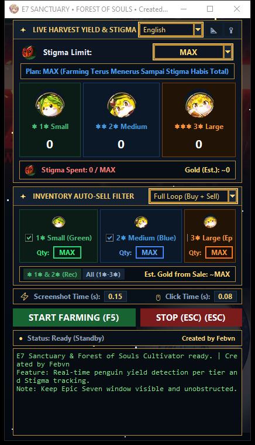

# E7 Penguin Farmer

**Alat otomasi budidaya dan penjualan penguin untuk Epic Seven (klien PC).**

<p align="center">
  
</p>

> **Language / Bahasa:** [English](README.md) | Bahasa Indonesia (file ini) | [한국어 / 日本語 / 中文 — didukung lewat UI aplikasi]

---

## Apa Fungsinya

Bot ini mengotomasi loop farming penguin yang repetitif di dalam Sanctuary Epic Seven (Forest of Souls → Growth Altar). Bot menangani pembelian penguin secara massal per batch 50 ekor, menghitung hasil per tier bintang secara real time, dan opsional menjual penguin dari inventori untuk gold — semuanya melalui pembacaan layar dan otomasi mouse di window klien PC.

Tiga mode operasi tersedia:

| Mode | Deskripsi |
|---|---|
| **Full Loop** | Beli penguin per batch → hitung hasil penetasan → buka inventori → jual otomatis tier yang dipilih |
| **Buy Only** | Beli penguin dan hitung hasil, tanpa jual |
| **Sell Only** | Lewati pembelian, langsung jual penguin yang sudah ada di inventori |

---

## Fitur

- **Pembelian batch** — Beli 50 penguin per batch, diulang sampai budget Stigma habis atau mencapai batas yang kamu set.
- **Tracking hasil real-time** — Menghitung berapa penguin 1★, 2★, dan 3★ yang didapat per batch dan total, ditampilkan langsung di GUI.
- **Auto-sell dengan filter tier** — Pilih tier mana yang dijual (1★, 2★, 3★) dan berapa banyak masing-masing. Default: jual 1★ dan 2★, simpan 3★ untuk EXP.
- **Preset budget Stigma** — Tombol preset untuk jumlah umum (51.000 / 25.500 / 10.200 / 5.100) atau ketik angka bebas. Mode "MAX" beli sampai Stigma benar-benar habis.
- **Pengaturan kecepatan** — Atur interval screenshot dan delay klik mouse sesuai performa PC kamu.
- **6 bahasa UI** — English, 한국어, 日本語, 繁體中文, 简体中文, Bahasa Indonesia. GUI ganti bahasa langsung tanpa restart.
- **Hotkey** — `F5` untuk mulai, `ESC` untuk berhenti darurat.
- **Window snapping** — Menempatkan window Epic Seven ke posisi (0,0) ukuran 906×539 dan bisa menempel GUI bot di sampingnya.
- **Notifikasi suara** — Bunyi notif saat farming selesai.

---

## Persyaratan

- **Windows 10 atau 11**
- **Python 3.10+** (virtual environment `.venv` sudah disertakan)
- **Epic Seven klien PC** (harus terlihat dan tidak terhalang window lain di layar)
- **Hak Administrator** (diperlukan agar input mouse/keyboard bisa berinteraksi dengan window game)

### Dependensi Python

Paket utama yang digunakan:

| Paket | Fungsi |
|---|---|
| `PyAutoGUI` | Pergerakan dan klik mouse |
| `PyGetWindow` | Mencari dan memposisikan window game |
| `keyboard` | Listener hotkey (F5, ESC) |
| `opencv-python` | Template matching untuk deteksi tombol/layar |
| `numpy` | Operasi array untuk pemrosesan gambar |
| `Pillow` | Screen capture dan tampilan gambar di GUI |

Daftar lengkap di [requirements.txt](requirements.txt).

---

## Cara Menjalankan

### Quick Start (Direkomendasikan)

Klik ganda salah satu file batch ini:

- **`penguinEpicSeven.bat`**
- **`run_penguin.bat`**

Keduanya melakukan hal yang sama: menjalankan `E7PenguinFarmer.py` menggunakan Python `.venv` yang sudah disertakan dan meminta elevasi Administrator secara otomatis.

### Start Manual

```bash
cd C:\a\Refreshshop
.venv\Scripts\python.exe E7PenguinFarmer.py
```

Jalankan terminal sebagai Administrator kalau start manual.

---

## Setup (Pertama Kali)

Jika folder `.venv` tidak ada atau kamu setup dari awal:

```bash
python -m venv .venv
.venv\Scripts\pip install -r requirements.txt
```

Lalu klik ganda `penguinEpicSeven.bat` untuk menjalankan.

---

## Cara Kerjanya

1. **Deteksi window** — Bot mencari window "Epic Seven", memindahkannya ke (0,0), resize ke 906×539.
2. **Navigasi** — Membuka Quick Menu → Sanctuary → Forest of Souls → Growth Altar (menggunakan template matching terhadap gambar referensi di `assets_penguin/`).
3. **Loop beli** — Klik Buy → Max → Buy All untuk setiap batch. Menunggu animasi penetasan, lalu membaca layar hasil untuk menghitung penguin per tier menggunakan pengenalan digit.
4. **Fase jual** — Membuka Inventory → tab Materials → menu Arrange → memilih tier penguin sesuai filter kamu → konfirmasi penjualan.
5. **Pelaporan** — Memperbarui counter GUI secara real time dan mencatat setiap langkah di log.

---

## Konfigurasi

Pengaturan disimpan ke `config_penguin.json` dan bertahan antar sesi:

```json
{
  "language": "en",
  "stigma": -1,
  "cost": 102,
  "mode": "full_auto",
  "sell_1": true,
  "sell_2": true,
  "sell_3": false,
  "topmost": false,
  "sound": true,
  "sell_1_qty": "MAX",
  "sell_2_qty": "MAX",
  "sell_3_qty": "MAX",
  "mouse_speed": 0.08,
  "screenshot_speed": 0.15
}
```

| Field | Arti |
|---|---|
| `stigma` | Batas budget. `-1` artinya unlimited (beli sampai habis). |
| `cost` | Biaya Stigma per penguin (default 102). |
| `mode` | `full_auto`, `buy_only`, atau `sell_only`. |
| `sell_1` / `sell_2` / `sell_3` | Apakah tier penguin tersebut dijual. |
| `sell_X_qty` | Berapa yang dijual per tier. `"MAX"` jual semua. |
| `mouse_speed` | Delay dalam detik antar aksi mouse. Makin kecil = makin cepat. |
| `screenshot_speed` | Delay antar tangkapan layar. Makin kecil = makin cepat tapi CPU lebih berat. |

---

## Referensi Nilai Gold

| Tier Penguin | Harga Jual |
|---|---|
| 1★ Small (Hijau) | 6.000 Gold |
| 2★ Medium (Biru) | 18.000 Gold |
| 3★ Large (Epic) | 54.000 Gold |

Satu batch = 50 penguin × 102 Stigma = 5.100 Stigma per batch.

---

## Troubleshooting

| Masalah | Solusi |
|---|---|
| Error "Window not found" | Pastikan klien PC Epic Seven terbuka dan judul window persis "Epic Seven". |
| Bot klik salah posisi | Window game harus di posisi (0,0) ukuran 906×539. Gunakan tombol "Snap E7" di GUI. |
| Deteksi lambat / gagal | Naikkan Screenshot Time ke 0.2-0.3s. Pastikan tidak ada window lain yang menutupi game. |
| Permission denied | Jalankan file bat (otomatis minta admin), atau buka terminal sebagai Administrator. |
| `.venv` tidak ditemukan | Jalankan `python -m venv .venv && .venv\Scripts\pip install -r requirements.txt` dulu. |

---

## Struktur Proyek

```
Refreshshop/
├── E7PenguinFarmer.py        # Bot utama + GUI (satu file)
├── config_penguin.json        # Pengaturan tersimpan (auto-generated)
├── requirements.txt           # Dependensi Python
├── penguinEpicSeven.bat       # Launcher (minta admin)
├── run_penguin.bat            # Launcher alternatif
├── LICENSE                    # Lisensi MIT
├── README.md                  # Versi English
├── README_ID.md               # File ini (Bahasa Indonesia)
└── assets_penguin/            # Gambar template untuk screen matching
    ├── digits/                # Template digit (0-4) untuk pembacaan angka
    ├── buy.png, max.png, ...  # Screenshot referensi tombol
    └── gui_*.png              # Ikon tier penguin untuk GUI
```

---

## Disclaimer

Ini adalah alat otomasi pihak ketiga. Tidak berafiliasi dengan, didukung oleh, atau terhubung dengan Smilegate atau Super Creative. Gunakan dengan risiko sendiri. Penulis tidak bertanggung jawab atas konsekuensi apa pun yang timbul dari penggunaan software ini dengan game tersebut.

---

## Lisensi

Proyek ini dirilis di bawah [Lisensi MIT](LICENSE).

Kamu bebas menggunakan, memodifikasi, dan mendistribusikan software ini. Lihat file LICENSE untuk ketentuan lengkap.

---

**Dibuat oleh Febvn**
